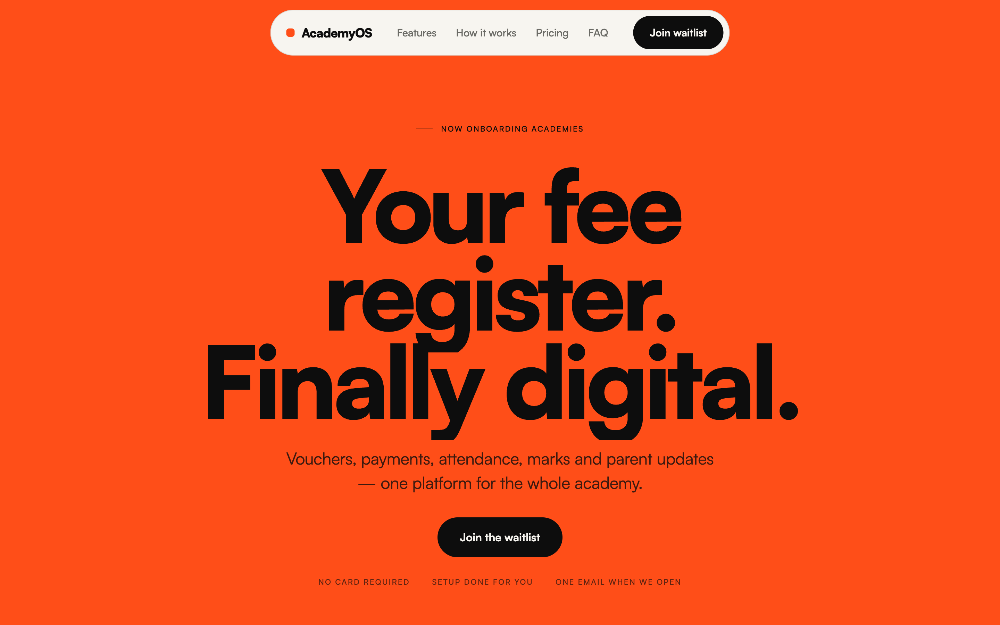
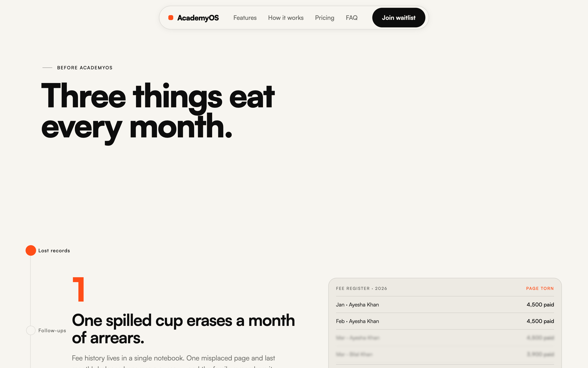
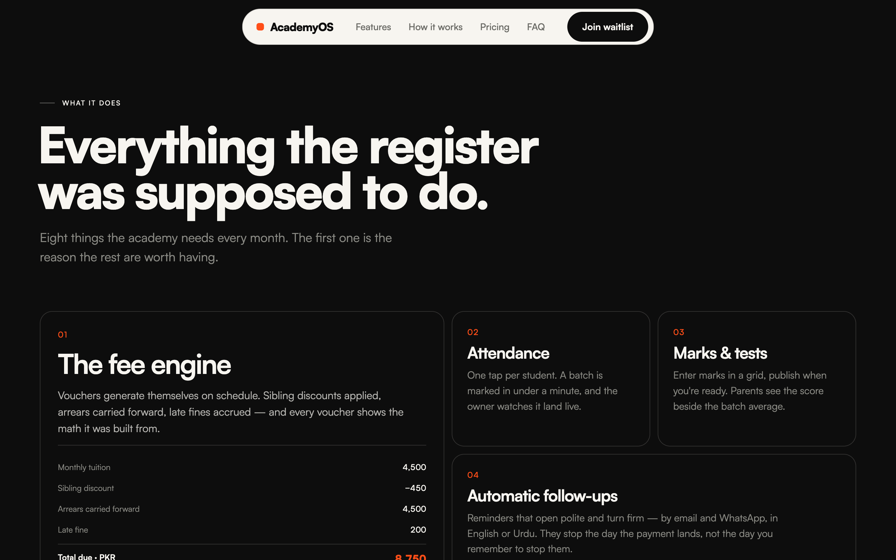
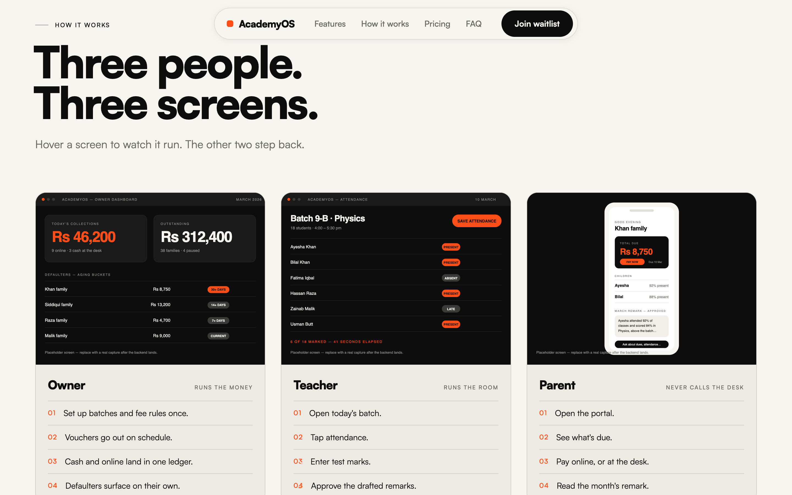
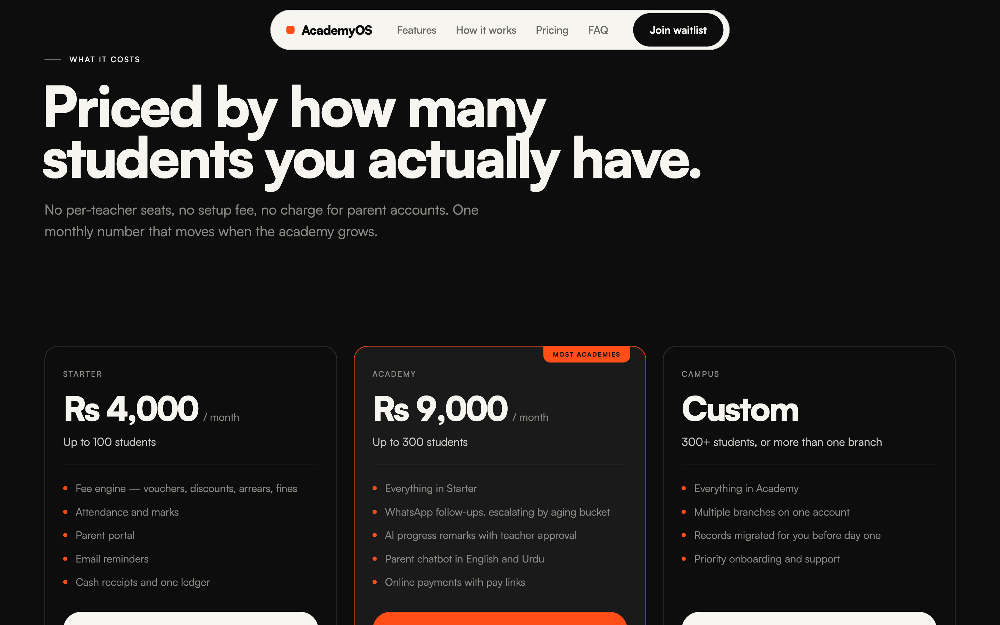
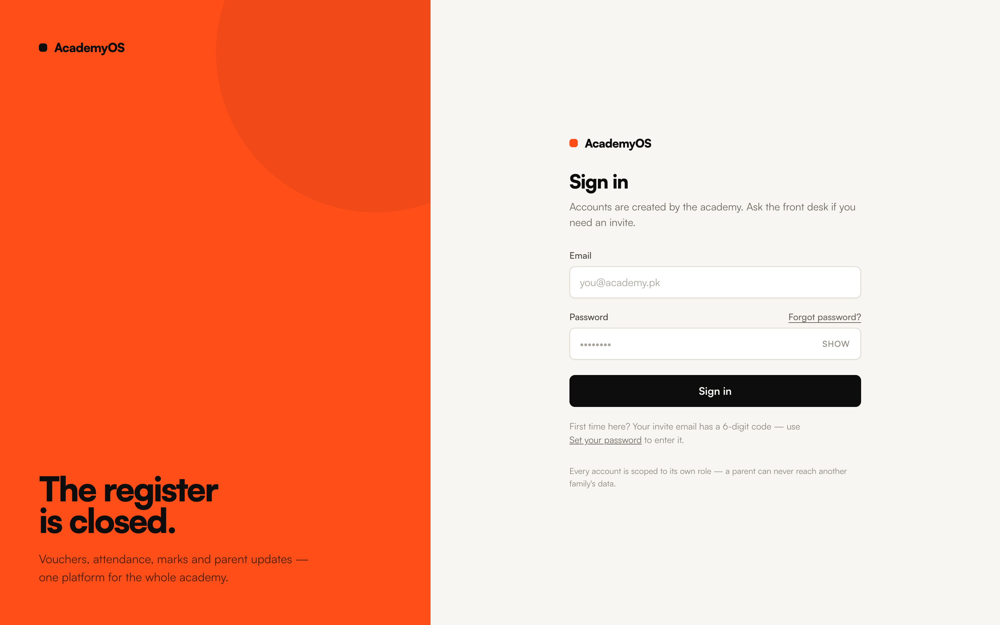

# AcademyOS — Digital Operations, Fee Engine & Parent Portal for Tuition Academies



**AcademyOS** is a full-stack operations, financial ledger, and parent-engagement platform built for tuition academies and coaching centers. It replaces paper fee registers and manual front-desk follow-ups with an **append-only financial ledger**, **automated monthly voucher generation**, **Stripe & cash collections**, **escalating bilingual (English & Urdu) fee reminders**, **teacher-approved AI progress remarks**, and a **parent-scoped agentic AI assistant**.

---

## Visual Tour

| The Problem Narrative | Core Platform Capabilities |
| :---: | :---: |
|  |  |

| Role-Based Experiences (Owner · Teacher · Parent) | Transparent Per-Academy Pricing |
| :---: | :---: |
|  |  |

### Role-Scoped Portal Authentication (`/login`)


---

## Dual-Implementation Repository Structure

This repository ships **two complete implementations** of the AcademyOS specification side by side—allowing the platform to be deployed either as a **100% custom-coded Next.js + Convex web application** or as a **Supabase (Postgres + RLS + Edge Functions) backend powering a Bubble.io frontend**:

```text
academy-os/
├── academyOS-Coded/               # Implementation 1: Full-Stack Next.js 15 + React 19 + Convex App
│   ├── app/                       # Marketing page (/) + Portals (/login, /admin, /teacher, /parent, /pay/success)
│   ├── components/                # 45+ React UI components across marketing, admin/, teacher/, parent/, and ui/
│   ├── convex/                    # 22-table Convex schema, @convex-dev/auth, crons, Stripe webhook, AI & ledger models
│   ├── lib/                       # Client formatting, toast state, and error utilities
│   ├── IMPLEMENTATION_MAP.md      # Requirement-by-requirement mapping to code
│   └── .env.example               # Environment template for local & production setups
│
├── academyOS-BubbleServer/        # Implementation 2: Supabase Backend for Bubble.io Frontend
│   ├── supabase/
│   │   ├── migrations/            # 45 SQL migrations (tables, RLS policies, RPCs, read models, triggers)
│   │   ├── functions/             # 17 Deno/TypeScript Edge Functions (webhooks, vouchers, AI, R2, email)
│   │   └── config.toml            # Supabase CLI & function verification config
│   ├── tests/rls/                 # 3 SQL negative-security & workflow regression test suites
│   ├── scripts/                   # Demo academic data seeders & Bubble schema helpers
│   ├── docs/                      # Complete Bubble.io API Connector guides, RLS docs & CSS/HTML shell snippets
│   └── .env.example               # Supabase Edge Function secrets template
│
└── docs/screenshots/              # High-resolution UI captures
```

| Architectural Layer | `academyOS-Coded/` (Full-Stack Coded) | `academyOS-BubbleServer/` (Supabase + Bubble.io) |
| :--- | :--- | :--- |
| **Frontend UI** | Next.js 15 (App Router) + React 19 (`app/`, `components/`) | Bubble.io visual app + custom shell (`docs/bubble-app-shell.css`) |
| **Database & Schema** | Convex Document-Relational Schema (`convex/schema.ts`) | Supabase Postgres (`20260729075633_initial_schema.sql`) |
| **Access Control** | Server-side guards (`convex/lib/authz.ts`) + `middleware.ts` | Postgres Row-Level Security (`20260729090000_rls_policies.sql`) |
| **Authentication** | `@convex-dev/auth` (Password + 6-digit Resend OTP invite/reset) | Supabase Auth JWTs + `invite-user` / `forgot-password` Edge Functions |
| **Server Logic** | Convex Queries, Mutations, Actions & HTTP Router (`convex/http.ts`) | 17 Deno Edge Functions (`supabase/functions/*`) + Postgres RPCs |
| **Scheduled Jobs** | Convex Crons (`convex/crons.ts`) | `pg_cron` + `pg_net` → `run-finance-jobs` & `draft-remarks` |
| **File Storage** | Convex File Storage (`convex/files.ts`) | Cloudflare R2 Presigned URLs (`r2-presign`, `student-photo`) |
| **Realtime Updates** | Native reactive Convex `useQuery` subscriptions | `supabase-js` Realtime HTML bridge firing Bubble events |

---

## Core Feature Pillars

1. **Append-Only Fee Engine & Financial Ledger**
   - **Immutable Ledger (`ledgerEntries` / `ledger_entries`):** Money is never edited in place. Vouchers, cash payments, Stripe payments, late fines, and admin adjustments are append-only rows. Every student/guardian balance and voucher status (`unpaid` → `partial` → `paid`) is dynamically computed from the ledger.
   - **Idempotent Monthly Vouchers:** Automatically computes `batch tuition (or student override) − sibling discount + prior arrears + accrued fines`, snapshots the active `feeRules` onto the voucher, and emails an itemized breakdown with a tokenized public pay link (`/pay/:token`).
   - **Cash & Stripe Checkout:** Front-desk admins record full or partial cash payments with auto-issued receipt numbers; parents pay online via **Stripe Checkout** credited exclusively by a signature-verified (`Stripe-Signature`), event-idempotent webhook.

2. **Three Role-Isolated Portals**
   - **Admin (`/admin`):** Dashboard KPIs, live today's attendance & collection tiles, batch/subject CRUD, student enrollment with sibling auto-linking, staff/parent invitations, voucher generation, cash receipts, ledger adjustments, aging buckets (`current`, `7+`, `14+`, `30+` days), reminder template versioning, AI remark publishing, and parent inquiry inbox.
   - **Teacher (`/teacher`):** Restricted strictly to assigned batches (`batchTeachers`). Sub-minute daily attendance tap-toggles (locked to today for teachers; historical corrections audited by admin), assessment creation & marks grid entry with publish gates, and an AI progress remark review queue with source fact chips.
   - **Parent (`/parent`):** Restricted strictly to the authenticated guardian's children. Per-child and family statements, itemized vouchers and receipts, attendance calendar with monthly percentages, published test results vs. batch average, approved monthly remarks, and an AI assistant widget.

3. **Grounded Bilingual AI (English & Urdu)**
   - **Monthly Progress Remarks:** Builds a structured data pack per student (attendance %, published test marks vs. batch average, month-over-month trend). Students with insufficient data are automatically flagged `low_data` instead of hallucinating filler. Parents only see `approved` remarks.
   - **Escalating Fee Reminders:** Daily sweep across 4 overdue aging buckets (`due_date`, `7d_gentle`, `14d_firm`, `30d_final` + admin escalation) using locked, versioned templates in English or Urdu (`guardians.languagePref`). Claim-then-send logging guarantees at most one message per voucher per bucket and halts the moment payment lands.
   - **Agentic Parent Chatbot:** Server-side tool loop (`get_outstanding_balance`, `get_voucher_details`, `get_attendance`, `get_upcoming_assessments`, `get_batch_schedule`, `get_published_results`, `create_inquiry`) where every tool executes strictly under the verified guardian's identity.

---

## Running the Project on Any Computer (Step-by-Step)

### Option A: Running the Full-Stack Coded App (`academyOS-Coded/`)

#### 1. Prerequisites
- **Node.js** v20+ and `npm`
- A free **[Convex](https://www.convex.dev/)** account
- *(Optional for emails, online payments & AI)* Free API keys from **[Resend](https://resend.com/)**, **[Stripe](https://stripe.com/)** (Test Mode), and **[OpenRouter](https://openrouter.ai/)**

#### 2. Clone & Install Dependencies
```bash
git clone https://github.com/venomeh/academy-os.git
cd academy-os/academyOS-Coded
npm install
```

#### 3. Initialize Your Convex Deployment
Create a local environment file and start Convex:
```bash
cp .env.example .env.local
npx convex dev
```
When prompted by `npx convex dev`:
1. Log in to your Convex account (or run `npx convex login`).
2. Choose **Create a new project** (e.g., `academy-os`).
3. Convex will automatically populate `CONVEX_DEPLOYMENT`, `NEXT_PUBLIC_CONVEX_URL`, and `NEXT_PUBLIC_CONVEX_SITE_URL` inside your `.env.local` and push the schema (`convex/schema.ts`) and functions.

#### 4. Configure Convex Environment Variables
In a second terminal (inside `academyOS-Coded/`), configure the required auth and service environment variables on your Convex deployment:

```bash
# 1. Generate and set JWT keys required by @convex-dev/auth
npx @convex-dev/auth

# 2. Set the application URLs
npx convex env set SITE_URL http://localhost:3000
npx convex env set APP_URL http://localhost:3000

# 3. (Optional) Email, Stripe Test Mode & OpenRouter AI keys
npx convex env set RESEND_API_KEY re_your_resend_api_key
npx convex env set RESEND_FROM_EMAIL "AcademyOS <onboarding@resend.dev>"
npx convex env set STRIPE_SECRET_KEY sk_test_your_stripe_secret_key
npx convex env set STRIPE_WEBHOOK_SECRET whsec_your_stripe_webhook_secret
npx convex env set STRIPE_CURRENCY pkr
npx convex env set OPENROUTER_API_KEY sk-or-v1-your_openrouter_api_key
npx convex env set OPENROUTER_MODEL openai/gpt-4o-mini
npx convex env set OPENROUTER_CHAT_MODEL openai/gpt-4o-mini
npx convex env set CHAT_DAILY_LIMIT 30
```

#### 5. Seed the Admin Account & Demo Academy Data
Run the built-in seeding actions once from the CLI to create the initial admin account and populate **Bright Future Academy** (batches, subjects, teachers, guardians, sibling families, 3 months of attendance, assessments, vouchers, ledger entries, and drafted remarks):

```bash
# Step 1: Bootstrap the academy and first Admin account
npx convex run seed:bootstrapAdmin '{"email":"admin@academy.pk","fullName":"Academy Owner","password":"Password123!"}'

# Step 2: Populate the full demo dataset (teachers, parents, students, vouchers, attendance, marks)
npx convex run seedDemo:seedDemoData '{}'
```

#### 6. Start the Next.js Development Server
With `npx convex dev` running in Terminal 1, start Next.js in Terminal 2:
```bash
npm run dev
```
Open **[http://localhost:3000](http://localhost:3000)** in your browser:
- **Marketing Landing Page:** `http://localhost:3000/`
- **Sign-In Portal:** `http://localhost:3000/login`

#### Demo Sign-In Accounts (after running `seed:bootstrapAdmin` + `seedDemo:seedDemoData`)

| Role | Email | Password | Portal Route |
| :--- | :--- | :--- | :--- |
| **Admin (Owner)** | `admin@academy.pk` | `Password123!` | `/admin` |
| **Teacher** | `sana.iqbal@brightfuture.pk` | `academy1234` | `/teacher` |
| **Teacher** | `rabia.noor@brightfuture.pk` | `academy1234` | `/teacher` |
| **Parent (Guardian)** | `khalid.ahmed@gmail.com` | `academy1234` | `/parent` |

*(Need to reset the demo data back to a clean slate while keeping the Admin account? Run `npx convex run resetDemo:wipeDemoData '{}'`.)*

---

### Option B: Running the Supabase + Bubble.io Backend (`academyOS-BubbleServer/`)

If you want to use the **Postgres + Row-Level Security + Deno Edge Functions** backend (either with a **Bubble.io** frontend or any REST/PostgREST client):

#### 1. Prerequisites
- **[Supabase CLI](https://supabase.com/docs/guides/cli)** (`brew install supabase/tap/supabase` or `npm i -g supabase`)
- A **[Supabase](https://supabase.com/)** project
- *(Optional)* **Cloudflare R2** bucket for presigned student photo uploads

#### 2. Link Your Supabase Project & Push the Schema
```bash
cd academyOS-BubbleServer
cp .env.example .env

# Log in and link to your Supabase project ref
supabase login
supabase link --project-ref <YOUR_PROJECT_REF>

# Push all 45 SQL migrations (tables, RLS policies, views, RPCs, triggers)
supabase db push
```

#### 3. Set Edge Function Secrets & Deploy Functions
Fill in your `.env` (and `.env.r2` if using Cloudflare R2), then push the secrets and deploy all 17 Edge Functions:
```bash
supabase secrets set --env-file .env
supabase functions deploy
```

#### 4. Verify Row-Level Security & Academic Integrity Tests
Run the SQL verification suites against your database to prove cross-family isolation, role guards, and append-only ledger rules:
```bash
psql "$DATABASE_URL" -f tests/rls/rls_negative_tests.sql
psql "$DATABASE_URL" -f tests/rls/academic_integrity_tests.sql
psql "$DATABASE_URL" -f tests/rls/full_academic_workflow_tests.sql
```

#### 5. Connect a Bubble.io Frontend
Detailed step-by-step guides for wiring Bubble.io's **API Connector**, **Realtime Bridge**, and custom CSS/HTML shells are included in [`academyOS-BubbleServer/docs/`](./academyOS-BubbleServer/docs):
- [`supabase_foundation_setup.md`](./academyOS-BubbleServer/docs/supabase_foundation_setup.md) — Week 1 Auth, JWT headers, and Realtime Bridge setup
- [`supabase_week1_structure.md`](./academyOS-BubbleServer/docs/supabase_week1_structure.md) — Complete schema, RLS policy matrix, and helper functions
- [`admin_api_setup_guide.md`](./academyOS-BubbleServer/docs/admin_api_setup_guide.md) — Every PostgREST & RPC endpoint configuration for the Admin Dashboard
- [`teacher_attendance_marks_guide.md`](./academyOS-BubbleServer/docs/teacher_attendance_marks_guide.md) — Teacher portal attendance & marks grid workflows
- [`bubble-app-shell.css`](./academyOS-BubbleServer/docs/bubble-app-shell.css) & [`login-ui-reference.html`](./academyOS-BubbleServer/docs/login-ui-reference.html) — Drop-in UI styling and login reference markup
